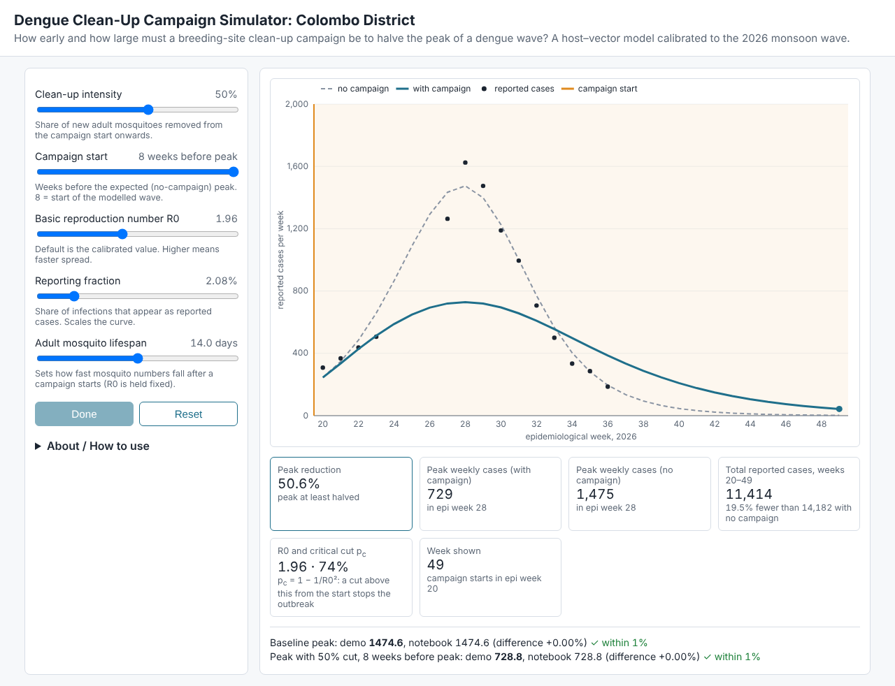
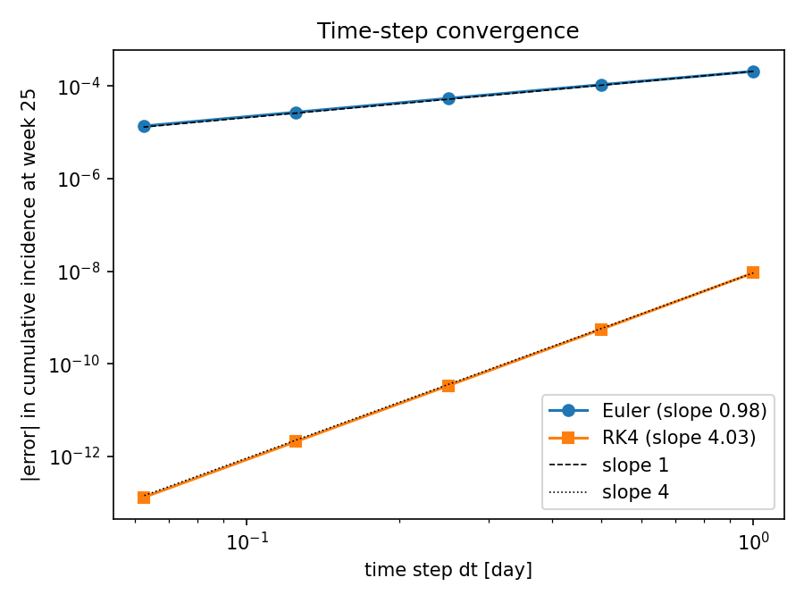
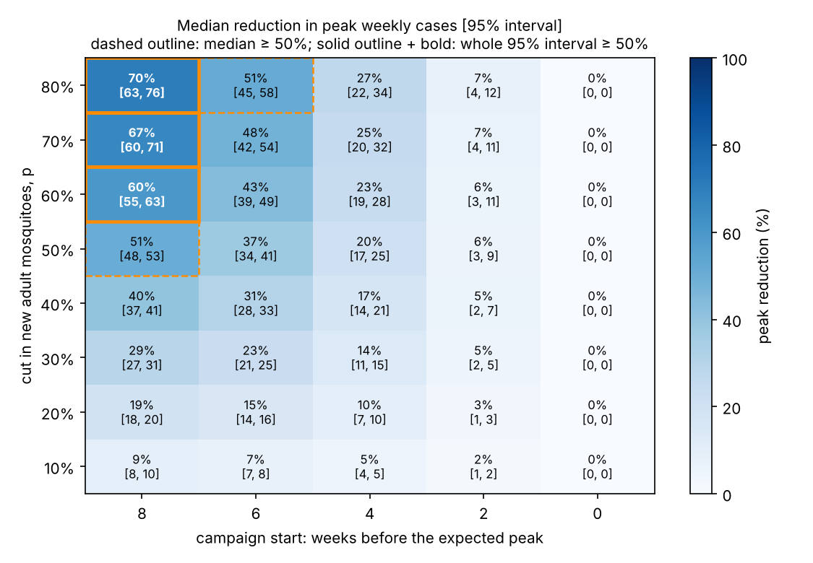

# Dengue Clean-Up Campaign Simulator: Timing versus Intensity in Colombo

A host–vector dengue model, calibrated to 2026 weekly case data for Colombo District with Bayesian MCMC, that asks how early and how large a breeding-site clean-up campaign must be to halve the peak weekly case count.

**[Live demo](https://kavindug13.github.io/dengue-cleanup-simulator/)** · [](https://colab.research.google.com/github/KavinduG13/dengue-cleanup-simulator/blob/main/notebook/dengue-cleanup-simulator.ipynb)



## The problem

Dengue is endemic in Sri Lanka, and Colombo District is consistently among the most affected districts. In 2026, weekly reported cases in Colombo rose from about 240 in mid-April to a peak of 1,625 in early July, after the south-west monsoon. The main community response is breeding-site clean-up, which reduces the number of new adult *Aedes* mosquitoes.

Health authorities have to decide when to start a campaign and how intensive to make it, and it is not obvious which matters more. This project asks: **how early and how large must a clean-up campaign be to halve the peak weekly case count?** Every answer comes with an uncertainty band from the calibrated model, not a single run.

## Quick start

**Notebook:** click the *Open in Colab* badge above, then *Runtime → Run all*. It uses only NumPy, SciPy, pandas and Matplotlib, which Colab already has. The whole notebook takes about 3 minutes on a laptop CPU and a few minutes more on a free Colab runtime; its last cell prints the exact run time.

**Web demo:** open the [live demo](https://kavindug13.github.io/dengue-cleanup-simulator/), or download this repository and double-click `docs/index.html`.

**Run locally (optional):**

```bash
pip install -r requirements.txt
jupyter notebook notebook/dengue-cleanup-simulator.ipynb
```

To rebuild the dataset from its source: `python data/make_dataset.py`.

## Using the demo

Five sliders set the campaign intensity (the share of new adult mosquitoes removed), how many weeks before the expected peak the campaign starts, the basic reproduction number R0, the reporting fraction and the adult mosquito lifespan. Press **Start** to watch the weekly case curve unfold against the no-campaign baseline and the reported cases; **Reset** restores the calibrated defaults. The panel shows the peak reduction, peak weekly cases with and without the campaign, total cases, R0 and the critical clean-up fraction, and two lines check the demo against the notebook's reference values (1474.6 and 728.8 cases per week). Full guide: [USER_GUIDE.md](USER_GUIDE.md).

## Model and mathematics

Humans follow an SEIR model and mosquitoes an SEI model. Humans are tracked as fractions of the effective susceptible population and mosquitoes per human:

$$
\frac{ds}{dt} = -\beta V_i s, \quad
\frac{de}{dt} = \beta V_i s - \sigma_h e, \quad
\frac{di}{dt} = \sigma_h e - \gamma i, \quad
\frac{dr}{dt} = \gamma i
$$

$$
\frac{dV_s}{dt} = \lambda(t) - \beta i V_s - \mu_v V_s, \quad
\frac{dV_e}{dt} = \beta i V_s - (\sigma_v + \mu_v) V_e, \quad
\frac{dV_i}{dt} = \sigma_v V_e - \mu_v V_i
$$

A campaign starting on day $t_c$ cuts mosquito recruitment by a fraction $p$: $\lambda(t) = m_0 \mu_v \left(1 - p\,\mathbf{1}[t \ge t_c]\right)$. The basic reproduction number is

$$
R_0^2 = \frac{\beta^2 m_0 \sigma_v}{\gamma\, \mu_v (\sigma_v + \mu_v)},
$$

so a campaign applied from the start stops the outbreak exactly when $p > p_c = 1 - 1/R_0^2$.

The equations are solved with hand-written explicit Euler and fourth-order Runge–Kutta (RK4) integrators at a time step of 0.5 days. The transmission rate, reporting fraction and initial infections are fitted to weekly reported cases with a hand-written random-walk Metropolis sampler and a negative-binomial observation model. Full derivations, assumptions and parameters: [THEORY.md](THEORY.md).

## Verification

Every check runs inside the notebook and ends in an `assert`, so a failure stops *Run all*.

| Check | Expected | Result |
|---|---|---|
| Human population conserved (s + e + i + r) | stays at 1 | maximum error 8.9 × 10⁻¹⁶ |
| Mosquito total after a campaign starts | follows the analytic exponential decline | maximum error 4.1 × 10⁻⁹ |
| No transmission (β = 0) | no new infections; i(t) decays as i₀e^(−γt) | passes |
| R0 formula vs next-generation matrix | equal | agree to 6 decimal places for four values of β |
| Outbreak threshold | grows just below p_c, dies out just above | growth rate +0.009/day at p_c − 0.03, −0.011/day at p_c + 0.03 |
| Time-step convergence | Euler order 1, RK4 order 4 | measured 0.98 and 4.03 |
| Own negative-binomial log-probability vs SciPy | equal | agree to 10⁻¹⁰ |
| Parameter recovery from synthetic data | true values inside 95% credible intervals | all three inside, R̂ ≤ 1.02; repeated on 5 synthetic datasets |
| Calibration to Colombo | converged chains; observed weeks inside 95% predictive band | R̂ ≤ 1.002; 14 of 14 weeks inside |
| Monte Carlo error of scenario results | falls as N^(−1/2) | fitted slope −0.507 |
| Web demo vs notebook | within 1% | 1474.6 and 728.8, difference 0.00% |



## Concepts applied

This project applies a host–vector compartmental epidemic model (SEIR humans, SEI mosquitoes), integrated with hand-written explicit Euler and fourth-order Runge–Kutta schemes whose error orders are measured. It uses Bayesian calibration with a random-walk Metropolis Markov chain Monte Carlo sampler and a negative-binomial observation model, and Monte Carlo propagation of posterior uncertainty into intervention scenarios with 95% intervals. The simulator is verified with conservation laws, the analytic R0 threshold, a next-generation-matrix check, a time-step convergence study and recovery of known parameters from synthetic data.

## Results

Calibrated to weeks 20–36 of 2026, the model gives **R0 = 1.96** (95% credible interval 1.83–2.08) and a critical clean-up fraction **p_c = 0.74** (0.70–0.77).

**Timing matters far more than intensity.** Halving the peak needs a campaign that starts about **eight weeks before the peak** and removes **at least half** of new adult mosquitoes. Starting four weeks or less before the peak never halves it, even at 80%, because removing breeding sites takes three to four weeks to show up in cases: existing adults live about two weeks, then the virus needs about ten days in the mosquito and five to six days in the person. For Colombo in 2026, eight weeks before the early-July peak was mid-May, at the onset of the south-west monsoon.

| Cut in new mosquitoes | 8 weeks before peak | 6 weeks before | 4 weeks before | 2 weeks before |
|---|---|---|---|---|
| 30% | 29.2% [27.3, 30.6] | 22.9% [20.8, 24.5] | 13.5% [10.7, 15.3] | 4.7% [1.9, 5.2] |
| 50% | **50.6% [47.5, 52.8]** | 37.4% [34.0, 41.2] | 20.4% [16.9, 24.9] | 5.7% [2.9, 8.8] |
| 60% | **60.0% [54.9, 63.2]** | 43.4% [39.1, 48.6] | 23.5% [18.6, 28.5] | 6.2% [3.4, 10.6] |
| 80% | **70.2% [62.6, 75.7]** | **50.8% [45.3, 58.2]** | 27.0% [22.1, 34.3] | 7.2% [4.4, 11.6] |

*Median peak reduction [95% interval] over 200 posterior draws. Bold: median at least 50%.*



Changing each fixed input by ±25% and refitting the model, the smallest cut that halves the peak (starting eight weeks before it) stays between 45% and 59%; the mosquito death rate matters most ([figures/tornado.png](figures/tornado.png)).

## Limitations and future work

- One wave, one serotype and homogeneous mixing across the whole district; real transmission varies between neighbourhoods.
- The susceptible fraction is fixed because, within a single wave, it cannot be separated from the reporting fraction. It is varied in the sensitivity analysis instead.
- A special dengue control week ran in Colombo on 15–21 June 2026, inside the fitted period. Its effect is absorbed into the baseline.
- Five of the 37 weeks in the source extraction are unusable and are left out of the fit (see [data/README.md](data/README.md)).
- With more time: a stochastic version to estimate the chance that an early campaign stops the outbreak completely, and rainfall-driven mosquito numbers.

## Key references

1. W. O. Kermack and A. G. McKendrick, "A contribution to the mathematical theory of epidemics," *Proc. R. Soc. Lond. A*, vol. 115, no. 772, pp. 700–721, 1927. doi: 10.1098/rspa.1927.0118
2. E. A. C. Newton and P. Reiter, "A model of the transmission of dengue fever with an evaluation of the impact of ultra-low volume (ULV) insecticide applications on dengue epidemics," *Am. J. Trop. Med. Hyg.*, vol. 47, no. 6, pp. 709–720, 1992. doi: 10.4269/ajtmh.1992.47.709
3. P. van den Driessche and J. Watmough, "Reproduction numbers and sub-threshold endemic equilibria for compartmental models of disease transmission," *Math. Biosci.*, vol. 180, no. 1–2, pp. 29–48, 2002. doi: 10.1016/S0025-5564(02)00108-6
4. N. Metropolis, A. W. Rosenbluth, M. N. Rosenbluth, A. H. Teller and E. Teller, "Equation of state calculations by fast computing machines," *J. Chem. Phys.*, vol. 21, no. 6, pp. 1087–1092, 1953. doi: 10.1063/1.1699114
5. Epidemiology Unit, Ministry of Health, Sri Lanka, *Weekly Epidemiological Report*, vol. 53, 2026. https://www.epid.gov.lk
6. T. S. Talagala, *denguedatahub: tidy datasets of dengue cases by country*, R package, 2026. https://github.com/thiyangt/denguedatahub
7. Department of Census and Statistics, Sri Lanka, *Census of Population and Housing 2024: Final Report*, 2026. https://www.statistics.gov.lk

Full list: [REFERENCES.md](REFERENCES.md).

## AI assistance

Developed with the help of AI coding and writing assistants. All code was reviewed, run and verified by the author.

## Licence and credits

Code: [MIT](LICENSE). Data: weekly notified dengue cases from the *Weekly Epidemiological Report*, Epidemiology Unit, Ministry of Health, Sri Lanka, as extracted in the [denguedatahub](https://github.com/thiyangt/denguedatahub) R package by T. S. Talagala (GPL-3). Population: Census of Population and Housing 2024, Department of Census and Statistics, Sri Lanka.
