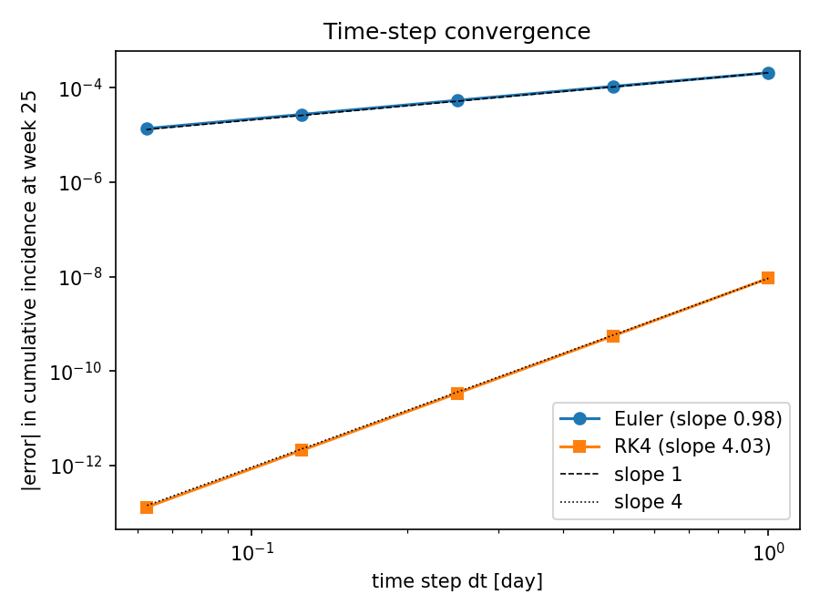

# Theory and mathematics

Reference numbers [n] refer to [REFERENCES.md](REFERENCES.md).

## 1. Problem formulation

Dengue spreads between people and *Aedes* mosquitoes. In Colombo District, weekly reported cases in 2026 rose from about 300 in mid-May to a peak of 1,625 in the week of 6–12 July, after the onset of the south-west monsoon [3], [4]. A breeding-site clean-up campaign removes the places where mosquitoes lay eggs, so it reduces the number of **new** adult mosquitoes; adults already alive die off naturally.

**Question:** how early and how large must a clean-up campaign be to halve the peak weekly case count?

**Quantities of interest:** the peak weekly reported cases with and without a campaign, the percentage reduction of that peak, and total reported cases, each with a 95% interval from the calibrated model. Supporting quantities: the basic reproduction number $R_0$ and the critical clean-up fraction $p_c$.

**System studied:** Colombo District (population 2,375,415 [19]) over the 2026 monsoon wave, epidemiological weeks 20–36 (11 May – 6 September 2026), extended to week 49 for the campaign scenarios so that delayed peaks are counted.

## 2. Assumptions

1. **Closed human population over one season.** Births, deaths and migration over four months are small compared with the number of infections.
2. **One serotype, lasting immunity within the season.** Reinfection with the same serotype within a season is negligible; multi-serotype structure is outside the scope of a single-wave study [9].
3. **Homogeneous mixing across the district.** A district-level model can only use district-level data; hot-spots are a stated limitation.
4. **The same transmission rate β from mosquito to human and from human to mosquito.** Only the product of the two rates enters $R_0$ and the epidemic curve, so a single fitted β loses nothing that the data could identify.
5. **A campaign is a constant fractional cut $p$ in the recruitment of new adult mosquitoes from its start day $t_c$.** This is how breeding-site removal acts; it does not kill flying adults.
6. **Constant reporting fraction ρ.** Reporting practice is unlikely to change much within one season.
7. **Fixed susceptible fraction (0.30).** $N$ enters the model only through $I_0/N$ and the case scale $\rho N$, so within one wave it cannot be separated from ρ; refitting with the fraction changed by ±25% leaves $R_0$ and the campaign results unchanged.
8. **Constant transmission over the fitted window.** The flat pre-monsoon weeks 16–19 are therefore excluded (Section 4.4).

## 3. Model equations

Humans are tracked as fractions of the effective susceptible population $N$: susceptible $s$, exposed $e$, infectious $i$, recovered $r$ (dimensionless), plus cumulative incidence $c$. Mosquitoes are tracked per human: $V_s$, $V_e$, $V_i$ (mosquitoes per human). Time $t$ is in days.

$$
\begin{aligned}
\frac{ds}{dt} &= -\beta V_i s, &
\frac{dV_s}{dt} &= \lambda(t) - \beta i V_s - \mu_v V_s,\\
\frac{de}{dt} &= \beta V_i s - \sigma_h e, &
\frac{dV_e}{dt} &= \beta i V_s - (\sigma_v + \mu_v) V_e,\\
\frac{di}{dt} &= \sigma_h e - \gamma i, &
\frac{dV_i}{dt} &= \sigma_v V_e - \mu_v V_i,\\
\frac{dr}{dt} &= \gamma i, &
\frac{dc}{dt} &= \sigma_h e .
\end{aligned}
$$

**Clean-up campaign** of intensity $p$ from day $t_c$:

$$\lambda(t) = m_0 \mu_v \left(1 - p\,\mathbf{1}[t \ge t_c]\right).$$

Without a campaign $V_s + V_e + V_i = m_0$ at all times; with one, the total relaxes to $m_0(1-p)$ as $m_0\left[1 - p\left(1 - e^{-\mu_v (t - t_c)}\right)\right]$.

**Observation model.** Expected reported cases in week $w$ are $\mu_w = \rho N \Delta c_w$, and reported cases follow a negative binomial with dispersion $k$:

$$y_w \sim \text{NegBin}(\mu_w, k), \qquad \text{Var}(y_w) = \mu_w + \mu_w^2 / k .$$

| Symbol | Meaning | Units | Value / range | Source |
|---|---|---|---|---|
| $\sigma_h$ | 1 / human intrinsic incubation period | 1/day | 1/5.5 | mean 5.9 d, 95% of cases 3–10 d [11]; 5.7–6.0 d [12] |
| $\gamma$ | 1 / human infectious period | 1/day | 1/5 | viraemia 4–5 days in most patients [13] |
| $\sigma_v$ | 1 / extrinsic incubation period in the mosquito | 1/day | 1/10 | 15 d at 25 °C, 6.5 d at 30 °C [11] |
| $\mu_v$ | adult mosquito death rate | 1/day | 1/14 ≈ 0.071 | within field estimates 0.033–0.595 per day [14] |
| $m_0$ | adult mosquitoes per human | – | 2 | assumed; absorbed by the fitted β |
| $N$ | effective susceptible population | people | 0.30 × 2,375,415 | population [19]; fraction assumed |
| $\beta$ | transmission rate | 1/day | fitted: 0.217 (0.202–0.230) | this project |
| $\rho$ | reporting fraction | – | fitted: 0.021 (0.018–0.024) | this project |
| $I_0$ | infectious people at the start of week 20 | people | fitted: 5,532 (4,173–7,408) | this project |
| $k$ | negative-binomial dispersion | – | 20 | assumed; varied ±25% |
| $p$ | campaign intensity (cut in recruitment) | – | 0–0.8 | scenario input |
| $t_c$ | campaign start | day | 0–8 weeks before the baseline peak | scenario input |

### Reproduction number and critical clean-up fraction

Linearising the infected compartments $x = (e, i, V_e, V_i)$ at the disease-free state ($s = 1$, $V_s = m_0$) gives $\dot x = (F - V)x$, with new infections

$$F = \begin{pmatrix} 0 & 0 & 0 & \beta \\ 0 & 0 & 0 & 0 \\ 0 & \beta m_0 & 0 & 0 \\ 0 & 0 & 0 & 0 \end{pmatrix}, \qquad
V = \begin{pmatrix} \sigma_h & 0 & 0 & 0 \\ -\sigma_h & \gamma & 0 & 0 \\ 0 & 0 & \sigma_v + \mu_v & 0 \\ 0 & 0 & -\sigma_v & \mu_v \end{pmatrix}.$$

The spectral radius of the next-generation matrix $K = FV^{-1}$ [10] is

$$R_0^2 = \frac{\beta^2 m_0 \sigma_v}{\gamma\, \mu_v (\sigma_v + \mu_v)} .$$

$R_0$ is a square root because transmission takes two steps, human to mosquito and back. A campaign from the start lowers the mosquito density to $m_0(1-p)$, so $R_0(p)^2 = R_0^2 (1-p)$, and the outbreak is stopped exactly when

$$p > p_c = 1 - \frac{1}{R_0^2} .$$

For the calibrated model $R_0 = 1.96$ (95% CrI 1.83–2.08) and $p_c = 0.74$ (0.70–0.77).

**Why timing matters.** A campaign only stops new adults. The adult population falls with time constant $1/\mu_v = 14$ days; the virus then needs about 10 days inside the mosquito ($1/\sigma_v$) and 5.5 days in the person ($1/\sigma_h$). A campaign therefore reaches reported cases three to four weeks after it starts.

## 4. Numerical method

### 4.1 ODE integration

For $dy/dt = f(t, y)$ with step $\Delta t$:

- **Explicit Euler:** $y_{n+1} = y_n + \Delta t\, f(t_n, y_n)$, global error $O(\Delta t)$.
- **Classical RK4:** $y_{n+1} = y_n + \frac{\Delta t}{6}(k_1 + 2k_2 + 2k_3 + k_4)$, with $k_1$ at the start of the step, $k_2$ and $k_3$ at the midpoint and $k_4$ at the end; global error $O(\Delta t^4)$ for smooth $f$ [20].

**Stability.** For the test equation $dy/dt = \lambda y$ on the negative real axis, Euler is stable for $\lambda\Delta t \ge -2$ and RK4 for $\lambda\Delta t \ge$ about $-2.79$ [20]. The fastest rates in the model are about 0.2 per day ($\gamma$, $\sigma_h$, $\sigma_v + \mu_v$), so at $\Delta t = 0.5$ days $\lambda\Delta t \approx -0.1$, far inside both regions.

**Time step.** $\Delta t = 0.5$ days was chosen for accuracy: the convergence study (Section 5) puts the RK4 error far below the observation noise, and one 30-week run takes about 6 ms.

**Campaign discontinuity.** $\lambda(t)$ jumps at $t_c$. If an RK4 step straddled the jump, the method would drop to low order, so the solver integrates in two segments that meet exactly at $t_c$, which is always a whole number of days and lies on the time grid.

**Starting state.** At the start of the fitting window the epidemic is already growing. The infected compartments start on the dominant eigenvector of $F - V$, scaled so that $I_0$ people are infectious. This removes the artificial two-week lag of starting with no exposed people and no infected mosquitoes. (The web demo finds the same eigenvector by power iteration on $F - V + I$.)

### 4.2 Bayesian calibration (Metropolis MCMC)

Parameters $\theta = (\beta, \rho, I_0)$ have uniform priors: $\beta \in [0.05, 1.5]$, $\rho \in [0.001, 1]$, $I_0 \in [1, 10^5]$. The sampler works in $\phi = (\log\beta,\ \text{logit}\,\rho,\ \log I_0)$, so proposals never leave the valid range. Because the priors are uniform on $\theta$, the log-posterior includes the log-Jacobian of the transform:

$$\log \pi(\phi \mid y) = \sum_w \log \text{NB}\big(y_w \mid \mu_w(\theta), k\big) + \log\beta + \log\rho + \log(1-\rho) + \log I_0 + \text{const}.$$

Missing weeks are excluded from the sum, not filled in.

**Algorithm** [15]: propose $\phi' = \phi + Lz$ with $z \sim N(0, I)$ and accept with probability $\min\big(1, \pi(\phi'|y)/\pi(\phi|y)\big)$.

**Settings:**

1. Nelder–Mead search for the posterior mode.
2. A 1,500-iteration pilot chain estimates the posterior covariance $\Sigma$.
3. Main chains use the fixed proposal covariance $2.38^2\Sigma/d$, $d = 3$ [16]: two chains of 6,000 iterations from over-dispersed starts, 1,500 burn-in each.

**Convergence:** Gelman–Rubin $\hat R$ [17] and effective sample size.

### 4.3 Monte Carlo scenario study and sensitivity

- **Scenarios:** 200 posterior draws × 8 intensities (10–80%) × 5 start weeks (8, 6, 4, 2, 0 weeks before each draw's own baseline peak). Each draw gives a peak reduction, and the 2.5th, 50th and 97.5th percentiles across draws give the reported interval. The Monte Carlo error of these summaries is measured directly (Section 5).
- **Sensitivity:** each fixed input is changed by ±25% and the model is **refitted** to the data (posterior mode) before the campaign is re-evaluated, because a perturbed model that no longer matches the observed wave says nothing useful.

### 4.4 Fitting window

A single constant transmission rate cannot reproduce the flat pre-monsoon weeks followed by the steep monsoon rise. At the best-fit parameters, the share of observed weeks inside the 95% predictive band was 78% for a window starting at week 16, 93% for week 19 and 100% for weeks 20 and 21. The window is therefore weeks 20–36, and the earliest campaign start the model can assess is 8 weeks before the peak.

## 5. Verification

All checks run in the notebook and end in an `assert`.

| Check | Expected | Obtained | Pass? |
|---|---|---|---|
| V1 Human conservation, $s+e+i+r$ | 1 | max error 8.9 × 10⁻¹⁶ | yes |
| V1 Mosquito conservation, no campaign | $m_0$ | max error 4.4 × 10⁻¹⁶ | yes |
| V1 Mosquito total after a campaign | $m_0[1 - p(1 - e^{-\mu_v(t-t_c)})]$ | max error 4.1 × 10⁻⁹ | yes |
| V2 No transmission, β = 0 | no new cases; $i = i_0 e^{-\gamma t}$ | no new cases; relative error 3 × 10⁻⁷ | yes |
| V3 Closed-form $R_0$ vs next-generation matrix | equal | agree to 6 decimals for β = 0.1, 0.2, 0.35, 0.5 | yes |
| V4 Threshold at $p_c$ = 0.90 (β = 0.35) | grows below, decays above | +0.0090 /day at $p_c$ − 0.03; −0.0111 /day at $p_c$ + 0.03 | yes |
| V5 Convergence order | Euler 1, RK4 4 | 0.98 and 4.03 | yes |
| V6 Eigenvector start conserves both populations | errors < 10⁻¹⁰ | passes | yes |
| V6 Own negative-binomial log-pmf vs SciPy | equal | agree to 10⁻¹⁰ | yes |
| V7 Parameter recovery from synthetic data, θ = (0.22, 0.02, 5000) | true values inside 95% CrI, $\hat R$ < 1.1 | all three inside; $\hat R$ ≤ 1.02; repeated on 5 datasets | yes |
| Colombo chains | $\hat R$ < 1.1, acceptance 15–50% | $\hat R$ ≤ 1.002; acceptance 34–35%; ESS 680–900 | yes |
| Posterior predictive coverage | about 95% of observed weeks | 14 of 14 (100%) | yes |
| Monte Carlo error of the scenario mean | slope −1/2 | −0.507 | yes |
| Web demo vs notebook | within 1% | 1474.6 and 728.8, difference 0.00% | yes |

## 6. Concepts applied

| Concept | Where it is used in this project |
|---|---|
| Compartmental epidemic models (SEIR humans, SEI vectors) | Model equations, notebook §2 and §3.1 |
| Basic reproduction number via the next-generation matrix; threshold behaviour | $R_0$, $p_c$, checks V3–V4 |
| Explicit Euler and fourth-order Runge–Kutta integration; error order and stability | Solvers in notebook §3.1, convergence study V5 |
| Bayesian inference with a negative-binomial observation model | Likelihood and posterior, notebook §3.4 |
| Markov chain Monte Carlo: random-walk Metropolis, proposal scaling, $\hat R$ and effective sample size | Calibration, notebook §3.4 and §5.1, recovery check V7 |
| Monte Carlo propagation of uncertainty and Monte Carlo error ($N^{-1/2}$) | Scenario grid with 95% intervals, notebook §5.2–5.4 |
| Sensitivity analysis with refitting | Tornado chart, notebook §5.5 |
| Verification and validation of a simulator | Conservation, analytic limits, convergence, parameter recovery, predictive check |

## 7. References

See [REFERENCES.md](REFERENCES.md).
