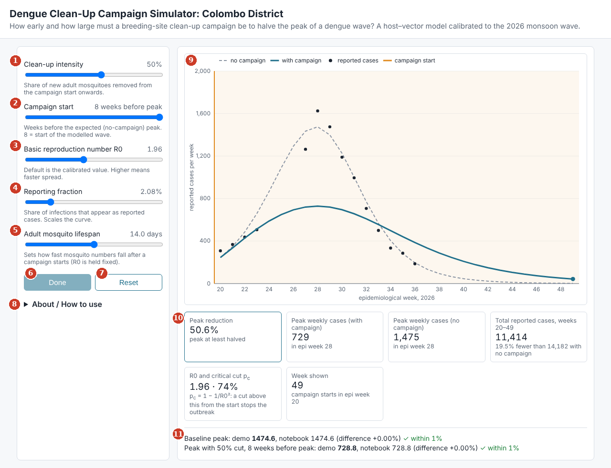

# User guide: Dengue Clean-Up Campaign Simulator web demo

**Open the demo:** https://kavindug13.github.io/dengue-cleanup-simulator/, or download this repository and double-click `docs/index.html`. It runs entirely in your browser (current Chrome, Edge or Firefox). Nothing is installed or uploaded, and it works offline.

The numbers in the screenshot match the numbered items below.

## Controls

| # | Control | What it does | Range | Default |
|---|---|---|---|---|
| 1 | Clean-up intensity | Share of **new** adult mosquitoes removed from the campaign start onwards | 0–90%, steps of 5% | 0% (no campaign) |
| 2 | Campaign start | Weeks before the expected no-campaign peak; 8 is the start of the modelled wave (epidemiological week 20) | 0–8 weeks | 8 |
| 3 | R0 | Transmission strength; the transmission rate β is recalculated from it | 1.2–3.0 | 1.96 (calibrated median) |
| 4 | Reporting fraction | Share of infections that appear as reported cases; scales the whole curve | 0.5–10% | 2.08% (calibrated median) |
| 5 | Adult mosquito lifespan | 1/μ_v; sets how fast mosquito numbers fall after a campaign starts. R0 is held fixed when it changes | 7–21 days | 14 days |
| 6 | Start / Pause | Animates the season one week at a time; Pause holds it, Start resumes. Shows "Done" at the end | — | — |
| 7 | Reset | Stops the animation and restores every default setting | — | — |
| 8 | About / How to use | Model, calibration, instructions and limitations | — | — |

Moving any slider updates the curves and outputs immediately, during or after a run.

## Reading the outputs

- **Plot (9):** weekly reported cases from epidemiological week 20 to week 49 of 2026.
  - Grey dashed line: no campaign.
  - Blue line: with the campaign, drawn week by week as the animation runs.
  - Black dots: cases actually reported in Colombo (weeks with data errors are omitted).
  - Orange line and shading: the campaign period.
- **Outputs (10):**
  - **Peak reduction:** percentage by which the campaign lowers the highest weekly case count; marked "peak at least halved" at 50% or more.
  - **Peak weekly cases:** with and without the campaign, in reported cases per week, with the epidemiological week of each peak.
  - **Total reported cases:** weeks 20–49, and the percentage saved.
  - **R0 and p_c:** a campaign larger than p_c from the start of the wave would stop the outbreak.
- **Uncertainty:** the demo shows one deterministic curve at the posterior-median parameters. The 95% intervals are in the notebook (section 5.3).

## Try this

1. **Halve the peak.** Set intensity to **50%**, keep the start at **8 weeks** and press **Start**. The peak falls by **50.6%**, from 1,475 to 729 reported cases per week.
2. **Start late.** Keep 50% and drag the start to **2 weeks**. The reduction drops to about **5%**: a campaign takes three to four weeks to show up in cases.
3. **Mosquito turnover.** Set intensity to 50% and the start to 6 weeks, then compare a lifespan of **9 days** with **21 days**. The peak reduction falls from **48.8%** to **26.9%**: short-lived mosquitoes disappear quickly once breeding sites are removed, long-lived ones keep biting for weeks.
4. **Cross the threshold.** Set R0 to **1.5**: the wave peaks later (week 31) and lower, and p_c drops to about 56%. A **60%** cut starting 8 weeks before the peak is above p_c, so the wave turns over in week 26 instead of 31 and the peak falls by **43%**. Crossing p_c stops growth, but the campaign still needs time to act.

## Check against the notebook

Two lines at the bottom of the page recompute reference values with the default calibrated parameters:

- baseline peak: **1474.6** reported cases per week (notebook section 5.6);
- peak with a 50% cut starting 8 weeks before the peak: **728.8**.

Both must agree within **1%**, and are shown green with "✓ within 1%". The demo's weekly curves match the notebook to within 4 × 10⁻¹⁵ in relative terms.

## Limitations

- One deterministic curve; no posterior uncertainty bands.
- Calibrated only on weeks 20–36 of 2026. Campaign starts earlier than 8 weeks before the peak, and R0 values far from 1.96, are extrapolations.
- A campaign is a constant, lasting cut in recruitment; real campaigns vary in coverage and fade.
- Homogeneous mixing across the district and a single serotype.
